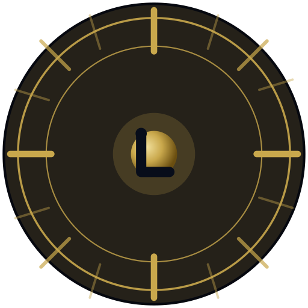

 

 

  

**Rigorous mathematics, written to be understood.**

Pure mathematics · Applied mathematics · History of ideas · Mathematics of AI

 

 

  

<!--
Optional README view counter.
This counts views of this GitHub README page only, not MathLumen website visitors.

  

-->

---

<strong>THE IDEA</strong>

## Mathematics deserves more than the answer

It deserves the reasoning, the intuition, the derivation, and the ideas that make the result meaningful.

MathLumen is an independent mathematics publication for readers who want to understand mathematics deeply. We explore the structures behind important ideas, the methods that make them useful, and the connections that carry mathematics into science and technology.

Our approach is simple: begin with a concrete question, make the reasoning visible, and build toward the general principle. We value precision without unnecessary obscurity, and accessibility without sacrificing mathematical depth.

---

## Inside MathLumen

### 01 · Research

New developments, open questions, mathematical discoveries, and ideas at the research frontier.

### 02 · Applied Mathematics

Numerical analysis, differential equations, optimization, mathematical modeling, and computation.

### 03 · Mathematics of AI

The mathematical ideas behind machine learning, neural networks, transformers, and scientific machine learning.

### 04 · History

The mathematicians, questions, and intellectual journeys behind the ideas that shaped the subject.

### 05 · Essays

Reflections on mathematical beauty, intuition, creativity, and the philosophy of mathematics.

### 06 · News

Mathematical prizes, research announcements, and significant developments, explained with context.

---

## A glimpse of the mathematics

Consider the heat equation on a periodic domain. In Fourier space, each mode evolves independently:

$$
\frac{d\hat{u}_k}{dt} = -\nu k^2 \hat{u}_k
\qquad\Longrightarrow\qquad
\hat{u}_k(t) = \hat{u}_k(0)\,e^{-\nu k^2 t}
$$

A transformation turns a coupled spatial problem into a family of simple evolution equations. The calculation is useful, but the important part is understanding why it works, what it reveals, and when the same idea can be used elsewhere.

That is the spirit of MathLumen: the result, the reasoning, and the connection.

---

## Explore, solve, create

### Problem of the Week

A regular challenge for curious minds, with problems at undergraduate, graduate, and competition level. Try a solution, submit your approach, and learn from the published discussion and archive.

[**Explore the problems →**](https://www.mathlumen.com/problem-of-the-week)

### MLTeX

A free online LaTeX editor for writing and previewing mathematical notation in your browser, without creating an account.

[**Open MLTeX →**](https://www.mathlumen.com/tools/mltex)

### Keep learning

| Feature | Description |
| :--- | :--- |
| **Weekly newsletter** | New articles, research highlights, and mathematical curiosities, every Sunday |
| **RSS feed** | Follow new publications in your preferred feed reader |
| **Search** | Find articles and topics across MathLumen. Press <kbd>Ctrl</kbd> + <kbd>K</kbd> on the website |

<a href="https://www.mathlumen.com/newsletter"><strong>JOIN THE NEWSLETTER</strong></a>
&nbsp; · &nbsp;
<a href="https://www.mathlumen.com/api/rss"><strong>FOLLOW THE RSS FEED</strong></a>

---

## Write for MathLumen

We welcome original mathematical writing, thoughtful perspectives, corrections, and suggestions from the community. Reach us at [editors@mathlumen.com](mailto:editors@mathlumen.com).

Have an article idea? Send us a manuscript, or a short pitch with an outline, along with a brief biography and relevant links.

1. **Send** your article or pitch.
2. **Review.** Submissions are considered for mathematical accuracy, originality, clarity, and fit with the publication.
3. **Publication.** Accepted articles are published under **your own name**, with an author profile showing your bio, photo, and links, and all of your articles in one place.

We look for writing that develops its ideas carefully: show the derivations, explain why the mathematics works, define notation, and acknowledge sources.

---

## Who reads MathLumen

Students, researchers, educators, engineers, and independent learners with an appetite for serious mathematics. Whether you are meeting an idea for the first time or exploring it at research level, we hope you find something here worth thinking about.

## About

MathLumen is founded and written by [**Akhilesh Yadav**](https://www.mathlumen.com/authors/akhilesh-yadav), an applied mathematician whose interests include reduced-order modeling and scientific machine learning.

---

**MATHEMATICS IS NOT ONLY SOMETHING TO SOLVE.**

**IT IS SOMETHING TO UNDERSTAND.**

 

<a href="https://www.mathlumen.com"><strong>www.mathlumen.com</strong></a>

 

© MathLumen. All rights reserved. Articles, text, and brand assets may not be reproduced or republished without permission.

